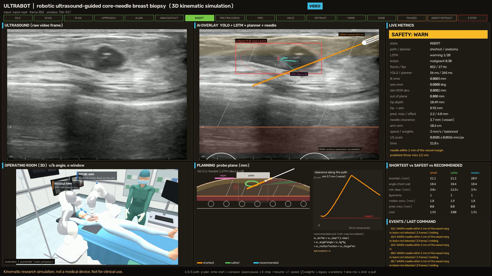
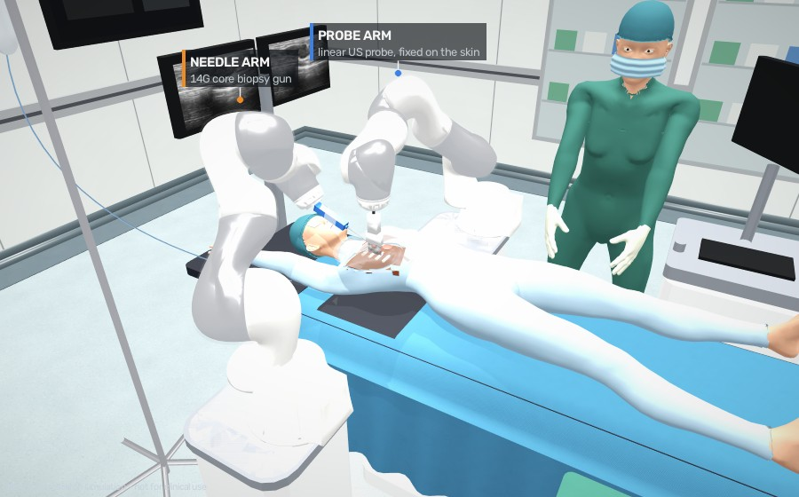
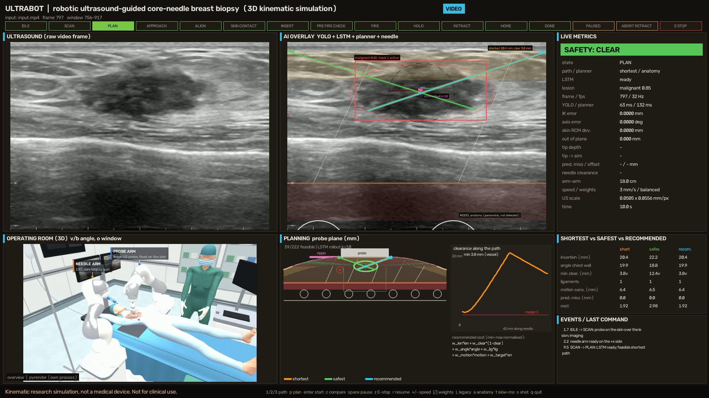
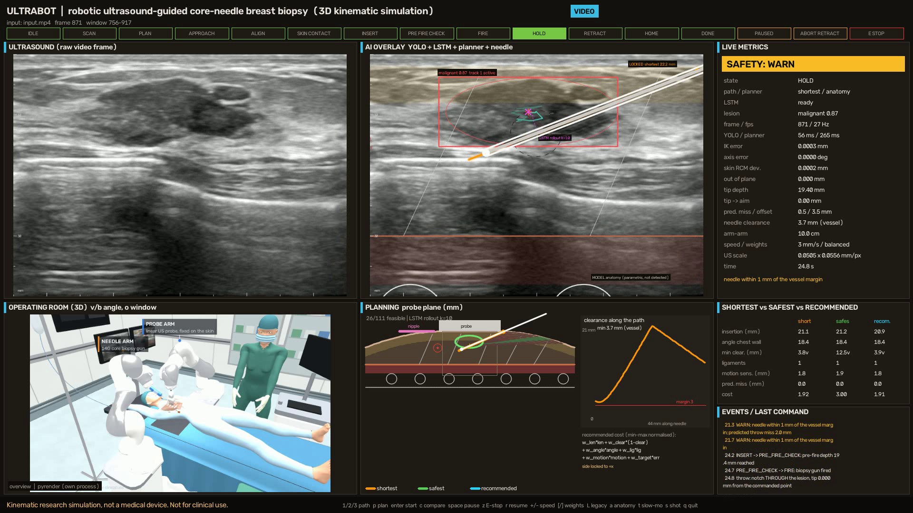
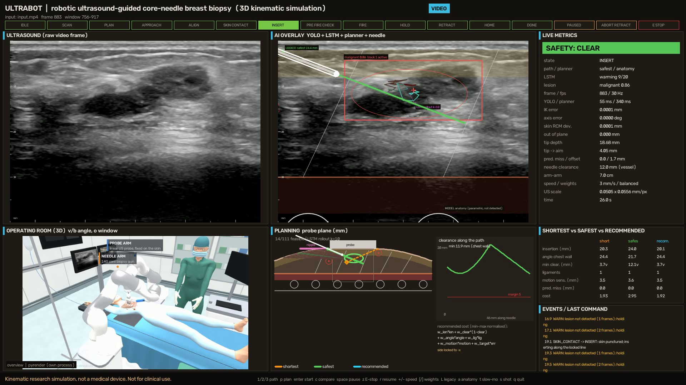
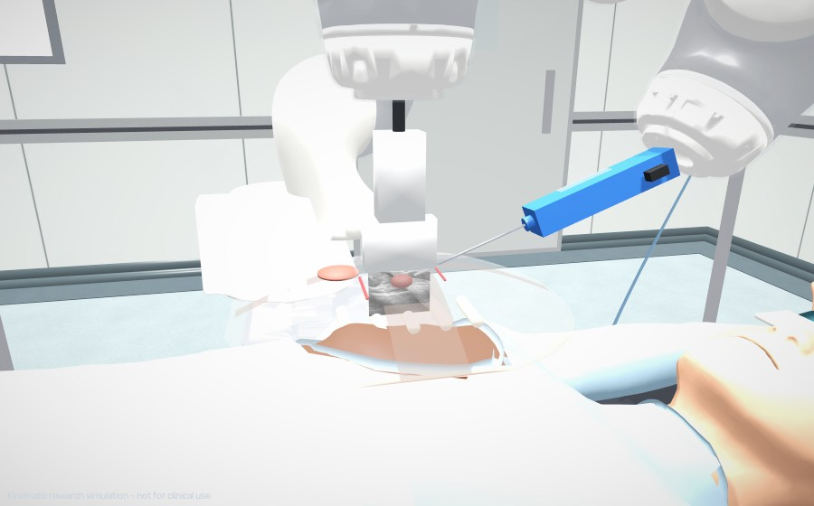
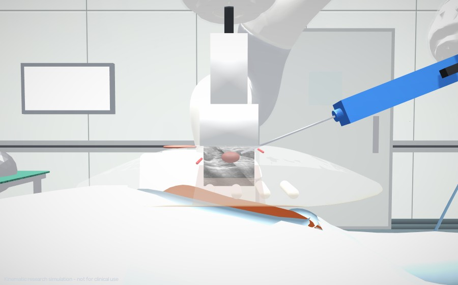
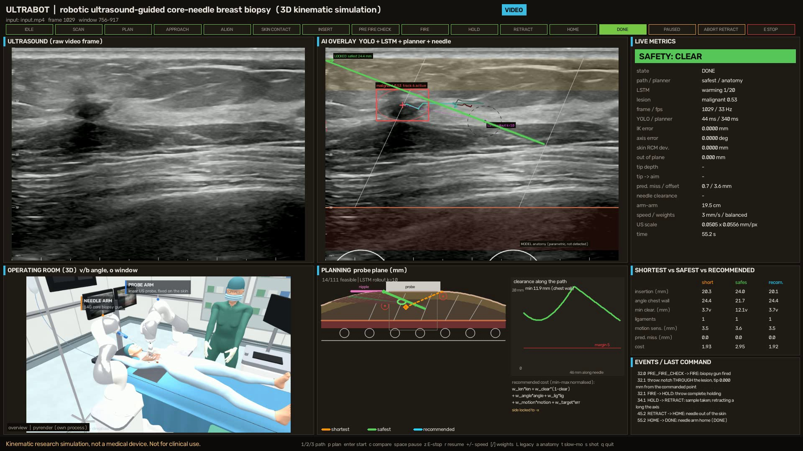

# UltraBot 3D — Robotic Ultrasound-Guided Breast Biopsy Simulation

A perception-in-the-loop 3D simulation of a two-arm robot performing an
**ultrasound-guided core-needle breast biopsy**. It runs the UltraBot
pipeline unchanged — **YOLO** finds the lesion, the **tracker** follows it,
the **LSTM** predicts where it moves — then an **anatomy-aware planner**
computes the **shortest**, **safest** and **recommended** needle paths in
millimetres, and two simulated **KUKA LBR iiwa** arms execute them: arm 1
holds the ultrasound probe on the breast, arm 2 inserts a 14 G biopsy needle
in-plane with sub-micron accuracy.



<p align="center"><i>Surgeon console: raw ultrasound, AI overlay (YOLO box, LSTM rollout, model anatomy, planned path and the needle drawn into the image), the 3D procedure room, the planning cross-section with the clearance profile, and live metrics.</i></p>

> This is a research / student project and a **kinematic** simulation. It
> is not a medical device: tissue is rigid, the anatomy around the lesion is
> a parametric model, and the mm scale comes from the configured scanner
> preset. Not for clinical use.

---

## What it does

| Part | What it does |
|---|---|
| **Perception** | Your `models/best.pt` (YOLO, benign / malignant) + `CenterIoUTracker` + `models/lstm_checkpoint.pth` (LSTM) on every frame — the same code as the dashboard, frame by frame. |
| **Units** | B-mode pixels → millimetres in the probe's image plane (vertical axis = depth) → world metres through the probe arm's kinematics. |
| **Anatomy model** | Skin, fat, gland, Cooper's ligaments, pectoral fascia and muscle, ribs, pleura, superficial vessels, nipple-areola — parametric, registered to the image, clearly labelled as a model. |
| **Planner** | 222 skin entries beside the probe. Hard limits: chest-wall clearance, vessel margin, ≤ 35° to the chest wall, needle length, gun vs probe/skin, robot reach. **Shortest** = least tissue; **safest** = largest minimum clearance; **recommended** = weighted cost. Refined with SLSQP. The original 2D planner is shown for comparison. |
| **LSTM compensation** | The LSTM is rolled out to the expected firing time; the throw is centred on the predicted lesion position. |
| **Probe arm** | Holds the linear probe on the skin over the lesion (6-DoF IK, 0.0001 mm). |
| **Needle arm** | Collision-free RRT-Connect transit, straight final approach, line locked at skin puncture (remote centre of motion), depth-only control, biopsy-gun throw, retraction. |
| **Safety** | Clearance to vessels / chest wall / ribs / pleura, needle visibility in the slice, lesion lost, predicted miss, throw vs chest wall, arm clearances, E-stop. It can only stop or retract, never push deeper. |
| **3D room** | KUKA arms in sterile sleeves, patient supine with the arm raised, translucent breast with the planning anatomy inside, the live ultrasound slice under the probe, monitor tower, scanner, radiologist, 11 camera angles and a zoomable window. |



---

## Quick start (Windows, NVIDIA GPU or CPU)

From the repository root (`UltraBot-Trajectory-Tracking`):

```bash
# 1. Python 3.10 or 3.11, then PyTorch (CUDA build first if you have a GPU)
python -m pip install torch torchvision --index-url https://download.pytorch.org/whl/cu124
#    CPU only:  python -m pip install torch torchvision

# 2. everything else
python -m pip install -r requirements.txt -r ultrabot_sim/requirements.txt

# 3. check (about 50 PASS / WARN / FAIL lines, ends with a full headless run)
python -m ultrabot_sim.selftest
```

`models/best.pt`, `models/lstm_checkpoint.pth` and `outputs/input.mp4` must
be in place (they are in this repository).

Run:

```bash
python -m ultrabot_sim.main --auto              # plans and performs the biopsy
python -m ultrabot_sim.main --compare           # shortest, then safest, same window
python -m ultrabot_sim.main                     # interactive: you choose and start
python -m ultrabot_sim.main --image scan.png --auto   # a single ultrasound image
```

The first run on a video pre-scans it once (cached in `ultrabot_sim/runs/cache/`)
to start just before the longest continuous lesion track: the sample video is
14 separate patient clips, and a biopsy needs ~25 s of continuous tracking.

From the dashboard: `streamlit run app.py` → run an analysis → **Trajectory
Planning** → **Open 3D Robotic Simulation**.

---

## Keys

| Key | What happens |
|---|---|
| `1` / `2` / `3` | select the **shortest** / **safest** / **recommended** path |
| `enter` | start the procedure with the selected path (confirm with `y`, cancel `n`) |
| `c` | **compare**: shortest, reset, safest on the same video window, then the result table |
| `p` | freeze / unfreeze the planning target |
| `space` | pause / resume |
| `z` | **E-stop** — both arms freeze |
| `r` | resume after E-stop (if the needle is inside, it retracts) |
| `+` / `-` | insertion speed (1–10 mm/s) |
| `[` / `]` | cost-weight preset: balanced / clearance-first / length-first |
| `L` | legacy 2D planner layer on / off |
| `a` | anatomy overlay on / off |
| `t` | slow-motion biopsy throw |
| `j` / `k` | slide the probe 1 mm (only before the approach) |
| `v` / `b` | next / previous 3D camera angle |
| `o` | big zoomable 3D window (drag = orbit, right-drag = pan, wheel = zoom) |
| `s` | screenshot to `ultrabot_sim/runs/shot_*.png` |
| `m` | time mark in the event log |
| `q` / `Esc` | quit |

Voice (optional, `--voice`, needs Vosk): "ana shortest / safest /
recommended / start / pause / resume / faster / slower / compare / yes /
no", and **"stop"** on its own at any time.

## Command-line options

| Option | Meaning |
|---|---|
| `--video PATH` | ultrasound video (default `outputs/input.mp4`) |
| `--image PATH` | single image: YOLO + planning; LSTM shown as *not available* |
| `--frames DIR` (`--fps N`) | folder of ordered frames |
| `--bundle PATH` | plan bundle written by the dashboard |
| `--demo` | synthetic data (SYNTHETIC badge everywhere) |
| `--weights`, `--lstm`, `--conf` | model paths, YOLO confidence (0.10) |
| `--start-frame N`, `--max-frames N`, `--no-auto-window` | where to play |
| `--auto` | plan and execute without key presses |
| `--compare` | shortest then safest on the same window |
| `--path shortest\|safest\|recommended` | path for `--auto` |
| `--planner anatomy\|legacy` | which planner drives the robot |
| `--speed N` | insertion speed mm/s (default 3) |
| `--weights-preset NAME` | balanced / clearance-first / length-first |
| `--depth-mm`, `--width-mm` | scanner imaging depth / probe width (mm scale) |
| `--auto-chestwall` | estimate the pectoral fascia from the image |
| `--seed N` | deterministic run |
| `--drop P`, `--jitter PX` | robustness experiments on the detections |
| `--headless` | no windows (logs and results only) |
| `--record runs/demo.mp4` | save the console as a video |
| `--seconds N`, `--once`, `--tag NAME` | stop after N s / when finished; log name |
| `--quality low\|medium\|high`, `--or-every N`, `--no-or`, `--or-window` | 3D panel |
| `--bullet-window`, `--voice`, `--fast` | PyBullet window, voice, no real-time wait |

## Results on the sample video

`python -m ultrabot_sim.main --compare --headless --once` (real YOLO + LSTM,
frames 756–917):

| | Shortest | Safest |
|---|---|---|
| outcome | DONE — SUCCESS | DONE — SUCCESS |
| insertion in tissue | 22.2 mm | 24.4 mm |
| angle to the chest wall | 23.0° | 22.8° |
| minimum clearance (planned / measured) | 3.7 / 3.7 mm (vessel) | 11.9 / 12.0 mm |
| specimen notch inside the lesion | 90 % | 55 % |
| fired tip vs commanded point | 0.0002 mm | 0.0001 mm |
| max IK error | 0.0014 mm | 0.0010 mm |
| max skin RCM deviation | 0.0002 mm | 0.0002 mm |
| max out-of-plane | 0.0009 mm | 0.0009 mm |
| procedure time (plan → needle home) | 28.3 s | 42.3 s |

All 7 success criteria pass for both paths.

Both throws pass through the lesion, every hard margin holds, and the robot
tracks its commands to a few thousandths of a millimetre. The **safest**
path keeps about 8 mm more clearance from the nearest vessel for a few mm more
needle in the tissue — the trade-off the planner is designed to expose.

`python -m ultrabot_sim.analyze` turns all runs into
`runs/figures/comparison.md` and figures.

---

## Checking that everything works

```bash
python -m ultrabot_sim.selftest              # A geometry ... F end to end
python -m ultrabot_sim.selftest --skip-e2e   # fast (no full run)
python -m pytest ultrabot_sim/tests -q       # 35 unit + integration tests
```

## Settings (`ultrabot_sim/config.py`)

| Setting | Default | Meaning |
|---|---|---|
| `US_DEPTH_MM`, `US_WIDTH_MM` | 40, 50 | scanner preset → mm per pixel |
| `PECTORAL_DEPTH_MM` | 30 | chest wall (pushed ≥ 6 mm below the lesion) |
| `VESSELS` | 2 tubes | model vessels (x, depth, radius) mm |
| `THROW_MM`, `NEEDLE_LEN_MM` | 22, 100 | 14 G biopsy gun |
| `MAX_ANGLE_TO_CHESTWALL_DEG` | 35 | steepest allowed needle |
| `CHESTWALL_CLEARANCE_MM`, `VESSEL_MARGIN_MM` | 5, 3 | hard margins |
| `MISS_ABORT_MM`, `MISS_ABORT_FRAMES` | 2.5, 3 | abort rule for lesion drift |
| `INSERT_SPEED_MM_S` | 3 | insertion speed |
| `MAX_TCP_SPEED`, `APPROACH_FINAL_SPEED` | 0.25, 0.05 m/s | free-space / final approach |
| `NEEDLE_MOUNT_DEG` | 30 | gun bracket angle on the flange |
| `WEIGHT_PRESETS` | 3 presets | recommended-path cost weights |
| `OR_QUALITY` | medium | 3D room: low / medium / high |
| `VIDEO_REALTIME` | True | play the video at its real speed |

## Troubleshooting

| Symptom | Fix |
|---|---|
| `[or-panel] ... failed` | the 3D room falls back to PyBullet's renderer automatically; `python -m ultrabot_sim.selftest` group E tells why. On Python 3.12+ install `PyOpenGL>=3.1.7`. |
| very slow (< 10 Hz) | YOLO on CPU: install the CUDA build of torch; use `--quality low`; the simulation stays correct when slower (it runs on simulation time). |
| "no lesion track found" | the video has no detection at `--conf 0.10`; try another video or `--demo`. |
| procedure ABORTED | read the reason in the console / `events_<tag>.csv`: the safety layer retracts when the lesion is lost, moves too far, or a margin would be crossed. That is intended behaviour. |
| first start takes ~10 s | the arm poses are solved once and cached in `runs/cache/`. |

## Project structure

```
ultrabot_sim/
  main.py          start here: input -> perception -> plan -> control -> console
  config.py        all settings
  inputs.py        video / image / frames / bundle / demo, auto window
  perception.py    UltraBot YOLO + tracker + LSTM, frame by frame
  lesion_model.py  lesion in mm, median filter, LSTM rollout, errors
  us_geometry.py   pixel <-> probe mm <-> world
  anatomy.py       parametric breast / chest-wall model
  planner.py       shortest / safest / recommended (+ legacy 2D)
  approach.py      RRT-Connect, shortcutting, min-jerk timing
  needle.py        14 G needle + biopsy gun
  rcm.py           skin remote centre of motion, depth profiles
  scene.py         PyBullet scene, KUKA iiwa arms, DLS IK, clearances
  control.py       state machine, insertion, compensation, aborts
  safety.py        safety layer
  us_render.py     drawing into the ultrasound image
  display.py       surgeon console
  or_render.py     realistic 3D room (pyrender), panel process
  or_viewer.py     big zoomable 3D window
  humans.py, props.py, orcam.py, fastgl.py   3D people, props, cameras
  commands.py, voice.py                      keys and optional voice
  metrics.py, perfmon.py, analyze.py         logs, performance, figures
  bundle.py        dashboard -> simulation plan bundle
  selftest.py      PASS / WARN / FAIL checks
  tests/           pytest suite
  docs/            PROJECT_UNDERSTANDING.md, TECHNICAL_NOTES.md, images
  assets/          MakeHuman CC0 body model + licences
```

Details: [docs/TECHNICAL_NOTES.md](docs/TECHNICAL_NOTES.md) ·
what the existing UltraBot code does: [docs/PROJECT_UNDERSTANDING.md](docs/PROJECT_UNDERSTANDING.md).

## Gallery

| Planning: shortest / safest / recommended on the live lesion | Biopsy gun fired: notch through the lesion |
|---|---|
|  |  |

| Safest path (other side of the probe), shortest result shown dashed | Needle close-up in the 3D room |
|---|---|
|  |  |

| Cross-section: ultrasound slice under the probe, lesion and needle | End of the comparison |
|---|---|
|  |  |

## Disclaimer

Academic research prototype for computer-science demonstration and
education. Kinematic simulation, not a medical device, not validated, not
for diagnosis, biopsy guidance or any clinical decision. Built in the style
of (and reusing parts of) the `internship_laproscopic_simulation` project.
